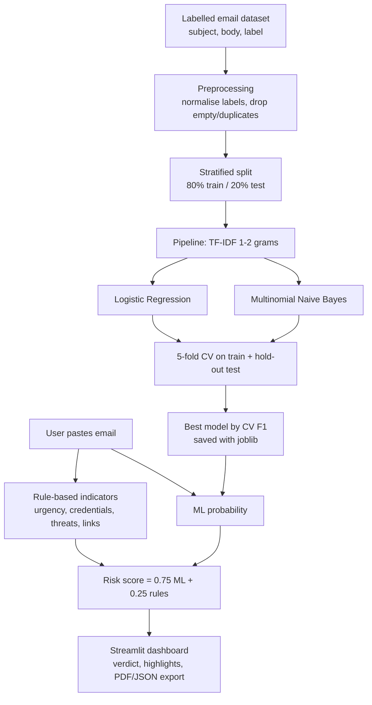

# System workflow / architecture

**Leakage control:** TF-IDF sits inside each scikit-learn `Pipeline`, so it is refitted on training folds only
during cross-validation; the test set is used once for final reporting and never for model selection.
